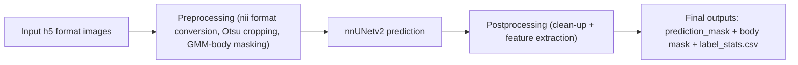

# FlySeg

**FlySeg** is a pre-trained, modular image segmentation pipeline tailored for *Drosophila* tissue segmentation using the [nnUNet v2](https://github.com/MIC-DKFZ/nnUNet) framework.  

It enables automated processing and segmentation of `.h5` 3D fluorescence imaging data for multiple target tissues, generating post-processed `.nii.gz` segmentation masks and statistical outputs in a streamlined and reproducible workflow.  

---

## Features

- End-to-end nnUNet v2 inference pipeline  
- Automated preprocessing: `.h5 → .nii.gz` (Otsu thresholding + Gaussian smoothing + 3D masking)  
- Automatic environment setup and inference execution  
- Post-processing with label cleanup and statistics  
- High-performance multi-threaded image processing  
- Command-line interface with flexible arguments  

---

## Installation

1. **Install via pip:**
```bash
pip install "git+https://github.com/walker-peterson/flowzoometrysoftware.git#subdirectory=src"
```

2. **(Optional) Install dependencies manually:**
```bash
pip install -r requirements.txt
```

---

## Usage Example

```bash
python -m flyseg.scripts.prediction  --input "***\test"   --output "***\prediction"   --application Segmentation   --info Control   --date 20260415   --organ CNS
```

### Parameters
- `--input`: Directory containing the input .h5 files. The test samples are provided in Flyseg\src\flyseg\sample_data.
- `--output`: Output directory  
- `--application`: Application type (e.g., Toxicology)  
- `--info`: Experiment batch info (e.g., Control)  
- `--date`: Experiment date (YYYYMMDD)  
- `--organ`: Target tissue segmentation, options:  
  - `CNS` — Central nervous system segmentation  
  - `Nubbin` — Nubbin region segmentation  

---

## Output Data Structure (Example)

```text
output_dir/
└── Toxicology/
    └── 20250419/
        └── PMMA_control/
            ├── Body_mask/                
            ├── imagesTs/                 
            ├── temporary/                
            ├── temporary_PP/             
            ├── prediction_mask/          
            ├── label_stats.csv           
            └── preprocessing_summary.csv 
```

---

## Full Uninstallation

To completely remove FlySeg and its cached model files:  

```bash
flyseg-clean-model   # or manually delete pretrained_model/
pip uninstall flyseg
```

```bash
python -m flyseg.scripts.prediction   --input "./test_data"   --output "./results"   --organ Nubbin
```

This will automatically run preprocessing, segmentation, and postprocessing, generating final masks and label statistics.  

### Pipeline Overview


---

## Contact
For questions or suggestions, please contact:  
Email: **peterson@flyworks.co.jp**
